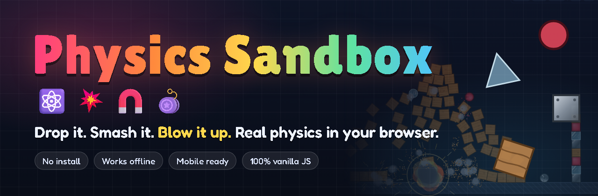
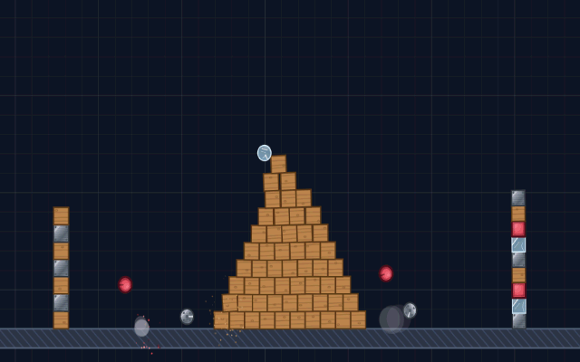
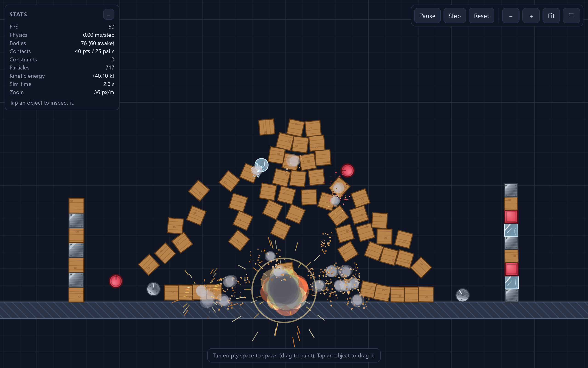
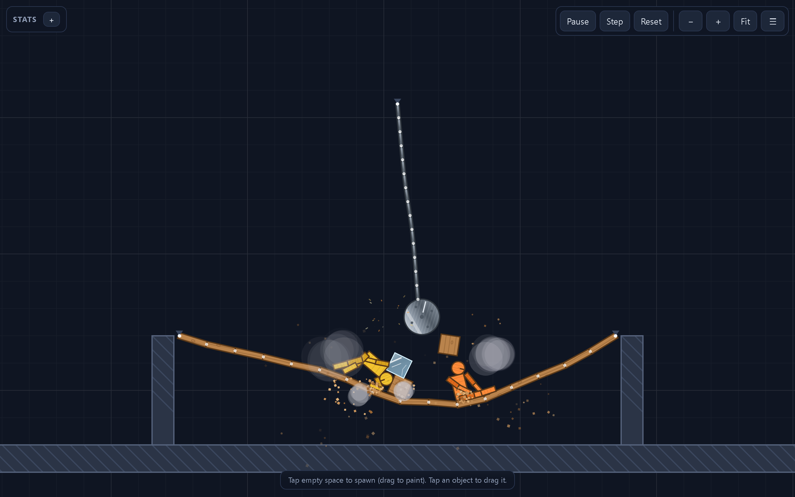
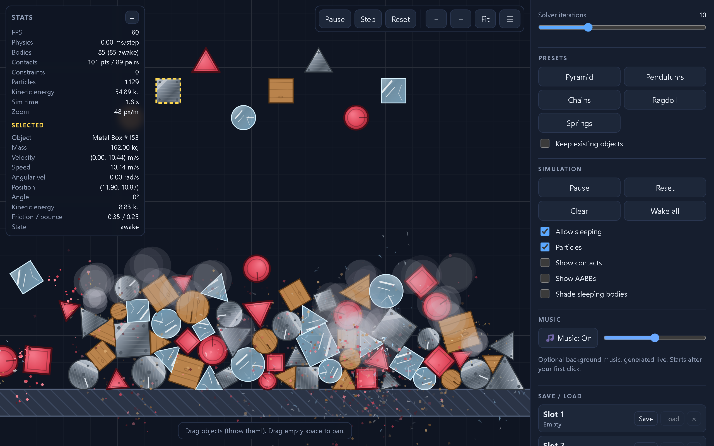
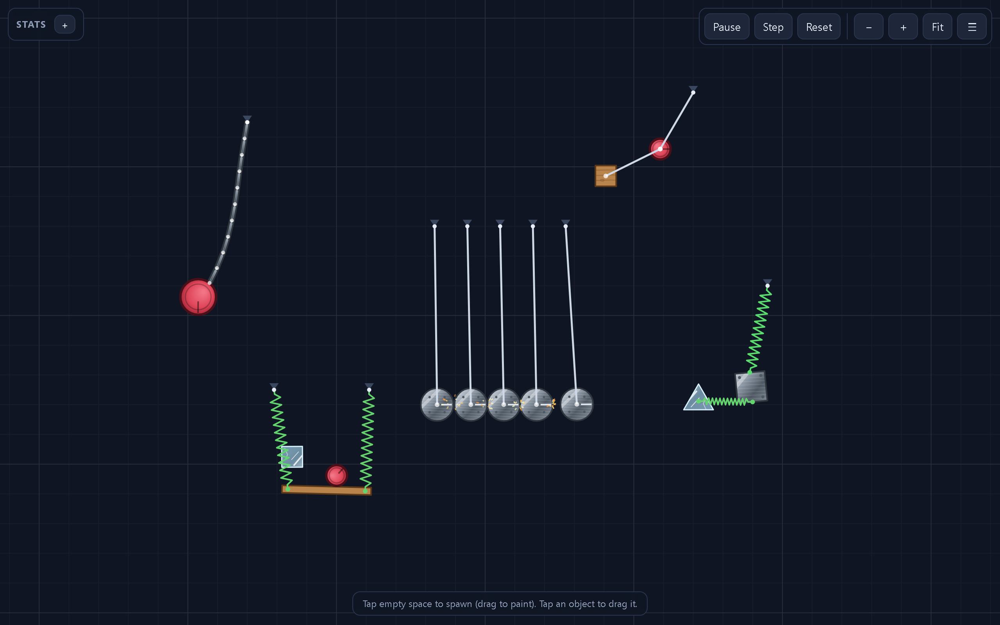
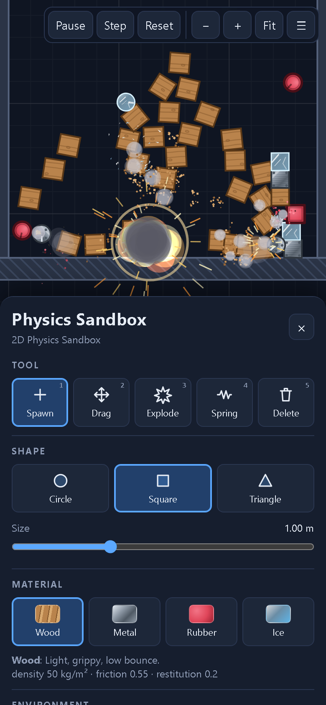

<p align="center">
  <a href="https://jaineil32624.github.io/Physics-Sandbox/">
    
  </a>
</p>

<p align="center">
  <a href="https://jaineil32624.github.io/Physics-Sandbox/"></a>
  <a href="https://github.com/jaineil32624/Physics-Sandbox/releases/latest/download/Physics-Sandbox.zip"></a>
  <a href="https://jaineil32624.github.io/Physics-Sandbox/"></a>
</p>

<p align="center">
  
  
  
  
  <a href="LICENSE"></a>
</p>

<h3 align="center">💥 Stack it, swing it, chain it, launch it, then blow the whole thing up. 🧱⛓️🪀</h3>

<p align="center">
  
</p>

<table>
  <tr>
    <td width="50%"><br><p align="center">💥 <b>Kaboom!</b> Blasts throw crates, sparks and smoke</p></td>
    <td width="50%"><br><p align="center">🪢 <b>Ragdolls + wrecking ball</b> on a sagging rope bridge</p></td>
  </tr>
  <tr>
    <td width="50%"><br><p align="center">🧱 <b>Wood, metal, rubber and ice</b> with live stats for the selected object</p></td>
    <td width="50%"><br><p align="center">🎱 <b>Newton's cradle</b>, chains, double pendulum and springs</p></td>
  </tr>
</table>

<p align="center">
  <br>
  📱 <b>Plays great on phones</b>: tap, drag, pinch and throw
</p>

## ✨ What you can do

- 🟦 **Spawn** circles, squares and triangles. Tap once, or drag to paint a whole stream of them.
- ✋ **Grab and throw** anything with your mouse or finger.
- 💥 **Blow stuff up** with an explosion tool. Pick the blast power and radius, then watch the shockwave, fireball, sparks and smoke.
- 🧱 **Four materials that really feel different**: light, grippy 🪵 wood; heavy, spark-throwing 🔩 metal; super-bouncy 🔴 rubber; slippery 🧊 ice.
- 🪀 **Springs**: tap two objects (or an object and the background) to connect them with a springy coil.
- ⛓️ **Chains and bridges**: a sagging rope bridge and a swinging wrecking ball.
- 🕺 **Crash-test ragdolls** with real joints (neck, shoulders, elbows, hips, knees).
- 🎱 **Pendulums**: Newton's cradle, a chaotic double pendulum and a swinging box.
- 🌍 **Bend the rules**: gravity from -20 to 30 m/s² (or flip it upside down), wind in either direction, and slow motion.
- 🏗️ **Stable stacking**: pyramids and towers stay standing until you knock them over.
- 📊 **Live stats**: FPS, body and contact counts, kinetic energy, plus the speed, mass and spin of whatever you tap.
- 💾 **Save and load** to 3 quick slots, or export and import your creations as JSON files.
- 🎵 **Optional chill background music**, generated live, with an on/off toggle and a volume slider.
- 🎬 **Instant demo scenes**: Pyramid, Pendulums, Chains, Ragdoll, Springs.
- 🔍 **Zoom and pan** with the mouse wheel, a pinch or the buttons, and step frame by frame when paused.

## 🚀 Play in 10 seconds

| | How |
|---|---|
| **1️⃣ Play online** | Open **[jaineil32624.github.io/Physics-Sandbox](https://jaineil32624.github.io/Physics-Sandbox/)**. That's it. |
| **2️⃣ Download and play offline** | Grab **[Physics-Sandbox.zip](https://github.com/jaineil32624/Physics-Sandbox/releases/latest/download/Physics-Sandbox.zip)**, unzip it, and double-click `index.html`. No install, no internet needed. |
| **3️⃣ On your phone** | Open the [play link](https://jaineil32624.github.io/Physics-Sandbox/), then use your browser's **Share → Add to Home Screen** for one-tap access. |

Works in Chrome, Edge, Firefox and Safari, on desktop and mobile.

## 🎮 Controls

| Input | Action |
|---|---|
| 🖱️ **Click / tap** | Use the current tool (spawn, explode, spring, delete) |
| ✋ **Drag an object** | Grab and throw it |
| 🖐️ **Drag empty space** (Drag tool), right / middle drag, or **two fingers** | Pan the camera |
| 🔍 **Mouse wheel / pinch / `+` `-`** | Zoom |
| ⏯️ `Space` | Pause / resume |
| ⏭️ `.` | Step one frame |
| 🔄 `R` | Reset the scene |
| 🧹 `C` | Clear all objects |
| 🧰 `1` – `5` | Spawn · Drag · Explode · Spring · Delete |
| 🔷 `Q` `W` `E` | Circle · Square · Triangle |
| 🧱 `M` / `Shift+M` | Next / previous material |
| 📏 `[` `]` | Smaller / bigger shapes |
| 🙃 `G` | Flip gravity |
| ❌ `Del` | Delete the selected object |
| 🎯 `F` | Fit the whole world in view |
| 🗂️ `H` | Show / hide the side panel |
| 💾 `Ctrl+S` | Quick-save to slot 1 |

<details>
<summary><b>🛠️ For developers: architecture, engine details, extending</b></summary>

<br>

Physics Sandbox is a 2D rigid-body physics sandbox that runs in the browser. It uses plain
HTML, CSS and JavaScript, with a physics engine written from scratch. It needs no
libraries, no build step and no server: open `index.html` and it runs.

### Features

#### Physics engine
- **Rigid bodies** with linear and angular velocity, mass, and moment of inertia computed from the shape.
- **Fixed timestep** (60 Hz) with an accumulator. Rendering interpolates between steps, so motion stays smooth on any refresh rate.
- **Collision detection**
  - Broadphase: a uniform spatial-hash grid for dynamic bodies. Static bodies are tested separately.
  - Narrowphase: circle/circle, polygon/circle, and polygon/polygon. Polygon pairs use SAT, then clip the reference face against the incident face to get up to 2 contact points.
- **Impulse-based solver**: sequential impulses with accumulated-impulse clamping, Coulomb friction, restitution, warm starting (contacts matched across frames), and speculative contact points.
- **Positional correction**: linear projection with slop for contacts, and NGS (non-linear Gauss-Seidel) projection for joints. Stacks stay put without sinking or jitter.
- **Sleeping**: bodies at rest go to sleep and wake when hit, dragged or exploded, or when gravity or wind changes. A 10-row pyramid settles and sleeps.
- **Gravity** can be adjusted from -20 to 30 m/s², or flipped with `G`.
- **Wind**: quadratic drag toward the wind velocity, scaled by each body's cross-section. The slider sets strength and direction, and animated streaks show the wind on screen.

#### Materials
| Material | Density (kg/m²) | Friction | Restitution | Look |
|---|---|---|---|---|
| Wood   | 50  | 0.55 | 0.20 | warm grain, knots, debris chips |
| Metal  | 200 | 0.35 | 0.25 | brushed gradient, rivets, **sparks** on impact |
| Rubber | 90  | 0.95 | 0.82 | matte red, thick rim, very bouncy |
| Ice    | 75  | 0.02 | 0.08 | translucent, highlights, cracks, shatters into shards |

#### Constraints and toys
- **Pendulums**: distance (rod) constraints to fixed pivots. The preset includes a Newton's cradle, a double pendulum and a box pendulum.
- **Springs**: damped Hooke springs between two bodies or between a body and a world anchor. They are colored by strain.
- **Chains**: box links joined by revolute (pin) joints. The preset includes a sagging rope bridge and a wrecking ball.
- **Ragdoll**: a crash-test dummy with 10 parts and 9 limited revolute joints (neck, shoulders, elbows, hips, knees). The parts share a collision group.
- **Particles**: impact bursts (sparks, chips, shards or dust, depending on material), plus explosions with a shockwave ring, fireball, sparks and smoke.
- **Explosion tool**: applies a radial impulse with distance falloff and adds a little camera shake.

#### Tools and UI
- Tools: **Spawn** (tap to spawn, drag to paint a stream of shapes; tapping an existing object grabs it), **Drag** (mouse-joint dragging that lets you throw objects; dragging empty space pans), **Explode**, **Spring** (connect two taps), **Delete** (removes bodies, springs and rods).
- Shapes: circle, square, triangle, with a size slider.
- Material picker that shows each material's properties.
- Sliders: gravity, wind, time scale, blast power and radius, spring stiffness and damping, solver iterations.
- Debug toggles: contact points and normals, AABBs, shading of sleeping bodies, particles on/off, sleeping on/off.
- Presets: Pyramid, Pendulums, Chains, Ragdoll, Springs. Tick "Keep existing objects" to add a preset to the current scene instead of replacing it.
- **Stats panel**: FPS, physics ms/step, body count (awake/total), contacts, constraints, particles, total kinetic energy, sim time and zoom. For the **selected body** it also shows mass, velocity, speed, angular velocity, position, angle, kinetic energy, friction/restitution and sleep state.
- **Camera**: zoom with the mouse wheel, a pinch, the +/- buttons or keys. Pan by right/middle-dragging, dragging with two fingers, using the arrow keys, or dragging empty space with the Drag tool. **Fit** frames the whole world.
- **Save/Load**: 3 localStorage slots, plus **Export/Import JSON** files.
- **Responsive**: on phones the panel becomes a bottom sheet (toggle with the ☰ button), and all interactions use Pointer Events, so touch works.

### Running

**Option 1: open the file directly.** Double-click `index.html`. Every script is a classic `<script>` that attaches to a single global namespace (`window.App1`), so the app works from `file://`.

**Option 2: serve it locally.**

```bash
npx serve .
# or
python -m http.server 8000
```

Then open the printed URL. Any modern browser works: Chrome, Edge, Firefox or Safari, on desktop or mobile.

### Architecture

```
Physics-Sandbox/
├── index.html          markup + script load order
├── css/style.css       layout, HUD, responsive bottom sheet
└── js/
    ├── math.js         Vec2 + numeric helpers                      (no deps)
    ├── materials.js    material registry (physics + visuals)       (no deps)
    ├── shapes.js       Circle / convex Polygon, mass properties    -> math
    ├── body.js         rigid body state, world-space geometry      -> math, materials, shapes
    ├── collision.js    spatial hash, narrowphase, contact solver   -> math, materials
    ├── constraints.js  distance, pin (revolute), spring, mouse     -> math
    ├── world.js        the simulation step pipeline                -> all of the above
    ├── particles.js    visual particle system (pooled)             -> math
    ├── camera.js       world <-> screen transform, zoom/pan        -> math
    ├── renderer.js     Canvas 2D drawing + material "painters"     -> math
    ├── input.js        pointer/touch/wheel gestures                -> camera
    ├── tools.js        interaction tools + ToolManager             -> body, shapes, constraints, renderer
    ├── presets.js      demo scenes + reusable builders             -> body, shapes, constraints
    ├── storage.js      (de)serialisation, localStorage, files      -> body, constraints
    ├── ui.js           panel, stats, slots, keyboard shortcuts     -> materials, presets, storage
    ├── music.js        optional procedural background music (Web Audio)
    └── main.js         App class, fixed-timestep game loop, boot   -> everything
```

The scripts are loaded in that order. Each file is an IIFE of the form
`(function (App1) { ... })(window.App1 = window.App1 || {})`, so modules register
themselves on the namespace (`App1` is the internal code namespace), and later files destructure what they need.

#### One physics step (`World.step`)
1. Snapshot the previous transforms (for interpolation) and refresh world-space geometry.
2. Propagate the awake state through constraints and collect the joined pairs that should not collide.
3. Run the broadphase (spatial hash) and then the narrowphase to build contact manifolds. Hard hits wake sleeping bodies, and contact points are matched to last frame's points for warm starting.
4. Apply forces (springs, wind, gravity) and integrate velocities, with mild damping.
5. Pre-step contacts and joints, apply warm starting, then run N velocity iterations.
6. Integrate positions, apply contact positional correction, then apply joint position correction (NGS).
7. Update sleep state and remove bodies that fell far outside the world.

Coordinates are in **meters** and **Y points down**, like the canvas, so positive gravity pulls downward. The camera's `zoom` is in pixels per meter.

### Extending Physics Sandbox

#### Add a material
In `js/materials.js` (or from any script loaded after it):

```js
App1.Materials.register({
  key: 'glass', name: 'Glass',
  density: 120, friction: 0.2, restitution: 0.1,
  style: 'glass',                       // reuse an existing painter...
  colors: { base: 'rgba(200,255,220,0.4)', light: '#fff', dark: '#6c9', stroke: '#e0fff0' },
  particles: { kind: 'shard', colors: ['#e8fff0', '#b0f0d0'] },
  description: 'Clear and brittle.'
});
```

The material picker in the panel is built from the registry, so the new
material shows up automatically. For a completely new look, add a painter:

```js
App1.Renderer.painters.neon = (ctx, body, { px, colors }) => {
  ctx.fillStyle = colors.base; ctx.fill();          // the body path is already built
  ctx.strokeStyle = colors.light; ctx.lineWidth = 3 * px; ctx.stroke();
};
```

#### Add a tool
Subclass `App1.Tools.Tool` in `js/tools.js`, implement `onDown/onMove/onUp/drawOverlay`,
and push an instance onto the `tools` array in `ToolManager`. Its button and keyboard
shortcut (`key`) are generated automatically. Return `'pan'` from `onDown` to turn the
gesture into a camera pan.

#### Add a preset
Push `{ id, name, description, build(world) }` onto `list` in `js/presets.js`. Position
everything relative to `world.bounds` (the ground surface is at `y = bounds.height`).
The reusable builders `createRagdoll`, `createChain`, `createPendulum`, `createPyramid` and
`createTower` are exported on `App1.Presets`.

#### Add a constraint type
Subclass `App1.Constraints.Constraint` and implement any of `applyForces`, `preStep`,
`solveVelocity` and `solvePosition`, plus `toJSON` and a static `fromJSON`. Then add it to
`App1.Constraints.registry` so saves can restore it, and add a case to
`Renderer.drawConstraint`.

#### Save format
Saves are versioned plain JSON (`format: "app1-simulation", version: 1`). Bodies keep
their ids, and constraints reference bodies by id. Imports are validated, and invalid
entries are skipped rather than crashing the app.

### Known limitations
- No continuous collision detection. Very small, very fast bodies can tunnel through thin geometry. Speeds are capped at 100 m/s to limit this.
- Only convex shapes are supported (concave input is converted to its convex hull). There are no compound bodies.
- Sleeping is per body rather than per island. Very tall, mixed-mass stacks can occasionally settle slightly unevenly.
- The world size depends on the screen's aspect ratio when you reset or load a preset. A save keeps its own walls, so a save from a wide screen still loads correctly on a phone (zoom or pan to see all of it).
- localStorage may be unavailable in some private-browsing modes or `file://` sandboxes. Export/Import JSON works everywhere.

</details>

---

<p align="center">
  <a href="https://jaineil32624.github.io/Physics-Sandbox/"></a>
  <a href="https://github.com/jaineil32624/Physics-Sandbox/releases/latest/download/Physics-Sandbox.zip"></a>
</p>

<h3 align="center">Like it? ⭐ Star the repo, it really helps!</h3>

<p align="center"><a href="LICENSE">MIT License</a> © 2026 Jaineil Rana</p>
